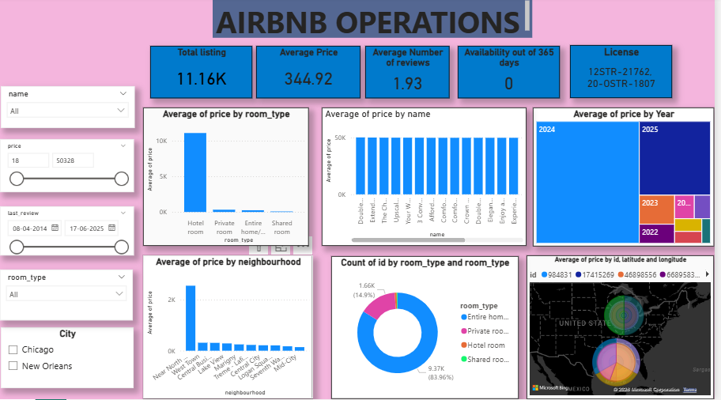
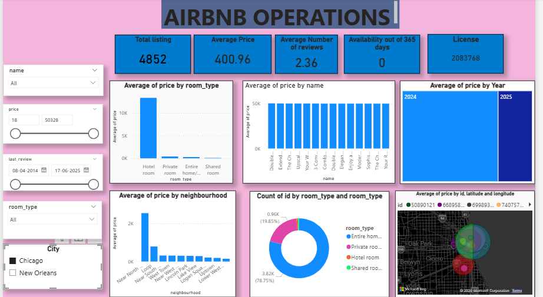
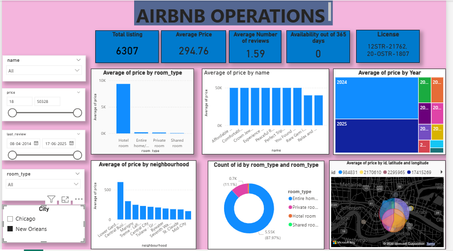
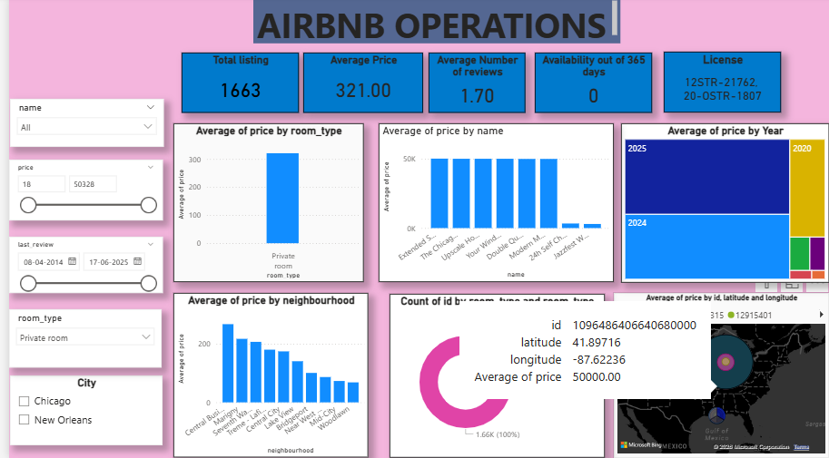

# 🏠 Airbnb Operations Dashboard (Power BI)

An interactive **Power BI dashboard** that analyses Airbnb listings in **Chicago** and **New Orleans**. It covers pricing, room types, neighbourhoods, review activity and geographic spread. Filters let you drill into any city, room type, price range or review period.



---

## 📌 Table of Contents
- [Project Overview](#-project-overview)
- [Objectives](#-objectives)
- [Dataset](#-dataset)
- [Tools & Technologies](#-tools--technologies)
- [Dashboard Walkthrough](#-dashboard-walkthrough)
- [Key Insights](#-key-insights)
- [Data Quality Observations](#-data-quality-observations)
- [Data Preparation](#-data-preparation)
- [How to Use This Dashboard](#-how-to-use-this-dashboard)
- [Repository Structure](#-repository-structure)
- [Future Improvements](#-future-improvements)
- [Author](#-author)

---

## 📖 Project Overview

Short-term rental hosts and analysts need a quick way to see how listings are priced and distributed across cities and neighbourhoods. This dashboard puts the most important metrics on one page, with slicers to explore the data by **city, room type, price range, listing name and last review date**.

---

## 🎯 Objectives

- Track headline KPIs: total listings, average price, average number of reviews, availability and license details
- Compare **pricing across room types** (hotel room, private room, entire home/apt, shared room)
- Identify the **most and least expensive neighbourhoods**
- Understand the **room-type mix** in each city
- Analyse **price trends by year**, using the last review date
- Visualise listings and prices **geographically** on a map
- Compare **Chicago vs New Orleans** side by side

---

## 📂 Dataset

| Field | Description |
|---|---|
| `id` | Unique listing ID |
| `name` | Listing name |
| `neighbourhood` | Neighbourhood of the listing |
| `latitude`, `longitude` | Location coordinates |
| `room_type` | Entire home/apt, Private room, Hotel room, Shared room |
| `price` | Listing price (range in the data: 18 to 50,328) |
| `number_of_reviews` | Total reviews received |
| `last_review` | Date of the most recent review (08-04-2014 to 17-06-2025) |
| `availability_365` | Days available out of 365 |
| `license` | License / registration number |
| `City` | Chicago or New Orleans |


> **Size:** about 11.16K listings in total (Chicago: 4,852, New Orleans: 6,307)

---

## 🛠 Tools & Technologies

- **Power BI Desktop**: dashboard design and visuals
- **Power Query**: data cleaning and transformation
- **DAX**: calculated measures and KPIs
- **Bing Maps visual**: geographic analysis

---

## 🖼 Dashboard Walkthrough

### 1️⃣ Overall View (All Cities)


Combined view of both cities:

| KPI | Value |
|---|---|
| Total listings | **11.16K** |
| Average price | **344.92** |
| Average number of reviews | **1.93** |

Visuals on this page:
- **Average price by room type**: bar chart
- **Average price by name**: bar chart of listing names
- **Average price by year**: treemap (2020 to 2025)
- **Average price by neighbourhood**: bar chart
- **Room type distribution**: donut chart (**83.96% Entire home/apt**, **14.9% Private room**)
- **Map**: average price by listing location

---

### 2️⃣ Chicago View



Filtered to **Chicago**:

| KPI | Value |
|---|---|
| Total listings | **4,852** |
| Average price | **400.96** |
| Average number of reviews | **2.36** |

- Room mix: **78.75% Entire home/apt**, **19.85% Private room**
- Top neighbourhoods by average price: **Near North Side, Loop, Near South Side**, West Town
- The year treemap shows reviews concentrated in **2024 and 2025**
- The map zooms to the Chicago area (Oak Park, Cicero, Berwyn, Lyons)

---

### 3️⃣ New Orleans View



Filtered to **New Orleans**:

| KPI | Value |
|---|---|
| Total listings | **6,307** |
| Average price | **294.76** |
| Average number of reviews | **1.59** |

- Room mix: **87.97% Entire home/apt**, **11.1% Private room**
- Top neighbourhoods by average price: **Lower Garden District, Central Business District, Marigny**, Treme-Lafitte
- The map zooms to New Orleans (Metairie, Jefferson, Bywater)

---

### 4️⃣ Room Type Drill-down (Private Room)



Filtered to **Private room** across all cities:

| KPI | Value |
|---|---|
| Total listings | **1,663** |
| Average price | **321.00** |
| Average number of reviews | **1.70** |

- The room-type slicer lets you isolate a single category
- Hovering over the map shows tooltips with `id`, `latitude`, `longitude` and `Average of price`
- Neighbourhood ranking changes with the filter (Central Business District, Marigny, Seventh Ward, Treme-Lafitte, etc.)

---

## 💡 Key Insights

- **Entire home/apt dominates** both markets, at about 79% of listings in Chicago and 88% in New Orleans.
- **Chicago is pricier** than New Orleans, with an average price of about 401 vs 295.
- **Chicago listings get more reviews on average** (2.36 vs 1.59).
- **Hotel rooms** show the highest average price of any room type, followed by private rooms and entire homes.
- A few neighbourhoods, such as **Near North Side** in Chicago, sit far above the rest in average price.
- **Recent years (2024 and 2025)** hold the largest share of reviewed listings.
- **New Orleans** has more listings than Chicago in this dataset (6,307 vs 4,852).

---

## ⚠️ Data Quality Observations

These affect how the numbers should be read:

- **Extreme price outliers.** Several listings have a price of about **50,000** (for example, one Chicago private room at lat 41.89716, long -87.62236 shows 50,000.00). This inflates averages, especially for hotel rooms and in the "price by name" chart.
- **Availability shows 0.** The "Availability out of 365 days" card reads 0, which suggests the column is empty or zero-filled in the source data. Review before drawing conclusions from it.
- **The License card shows text values** (registration numbers), so it is informational only and not a metric.
- **Year is based on `last_review`**, so it reflects review activity and not when the listing was created.

---

## 🧹 Data Preparation

Steps performed in **Power Query**:

- [Removed duplicates and null records]
- [Corrected data types (dates, numbers, text)]
- [Merged Chicago and New Orleans data and added the `City` column]
- [Handled missing values in `last_review`, `license`, etc.]

Main **DAX measures** used:

```DAX
Total Listing = COUNT(Listings[id])
Average Price = AVERAGE(Listings[price])
Average Number of Reviews = AVERAGE(Listings[number_of_reviews])
```
> Replace with your actual measure names and table names.

---

## ▶️ How to Use This Dashboard

1. Download or clone this repository:
   ```bash
   git clone https://github.com/mahisoft-link/Powerbi_dashboard_For_AIRBNB
   ```
2. Install **Power BI Desktop** (free): https://powerbi.microsoft.com/desktop/
3. Open `project_powerbi.pbix`.
4. Use the slicers on the left to filter:
   - **Name**: search a specific listing
   - **Price**: set a minimum and maximum
   - **Last review**: choose a date range
   - **Room type**: pick a room category
   - **City**: Chicago or New Orleans
5. Hover over any chart or map point for tooltips, and click a bar or slice to cross-filter the other visuals.

---

## 📁 Repository Structure

```
├── project_powerbi.pbix      # Power BI dashboard file
├── data/                     # Dataset (CSV files)
├── images/
│   ├── powerbi1.png          # Overall view
│   ├── powerbi2.png          # Chicago view
│   ├── powerbi3.png          # New Orleans view
│   └── powerbi4.png          # Private room drill-down
└── README.md
```

---

## 🚀 Future Improvements

- Exclude or cap price outliers (for example, using median instead of mean)
- Fix or replace the availability column to enable occupancy analysis
- Add host-level analysis (hosts with multiple listings)
- Add seasonality and monthly trend analysis
- Add more cities for broader comparison
- Publish to Power BI Service for a live shareable link

---

## 👤 Author

**Mahender Negi**
AI Engineer / Data Science Professional | New Delhi, India

⭐ If you found this project useful, please star the repository!
